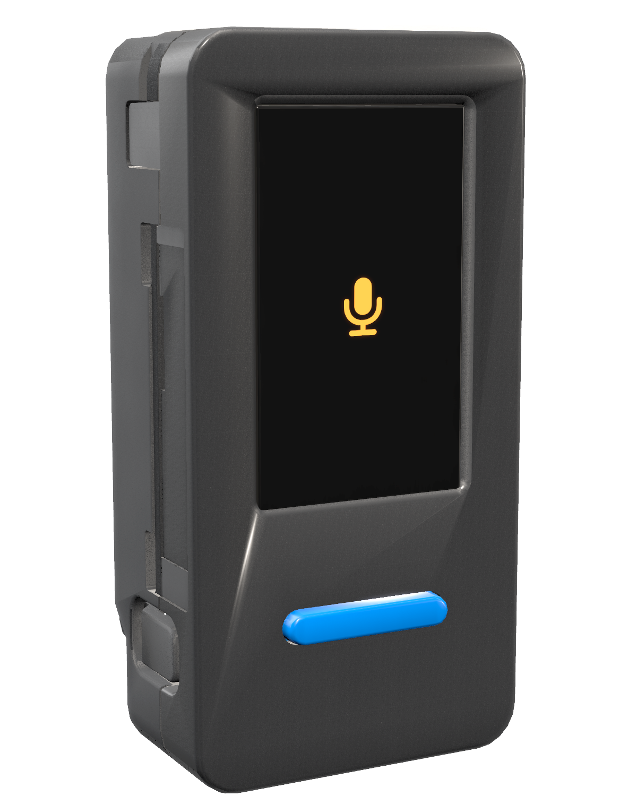
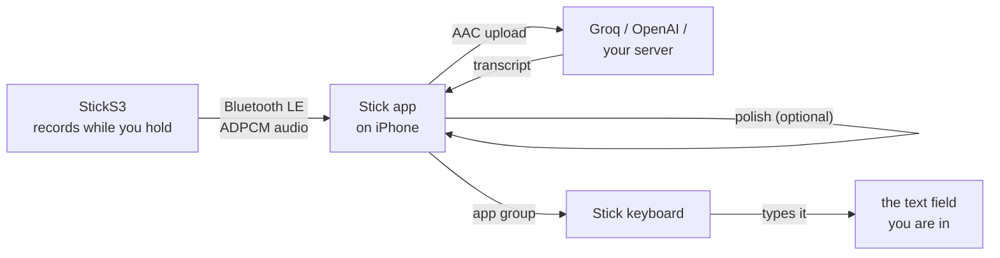
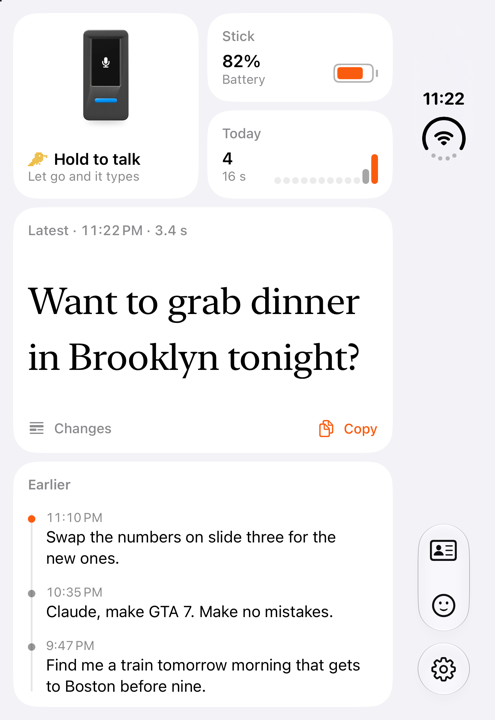

<div align="center">



# M5Stick Dictation

**Press a button, talk, and the text lands in whatever you are typing on your iPhone.** An M5Stack StickS3 records; the iPhone transcribes and types it through its own keyboard.

[](LICENSE)
[](#build-the-app)
[](https://docs.m5stack.com/en/core/StickS3)
[](#flash-the-stick)

[English](README.md) · [繁體中文](README.zh-TW.md)

</div>

> [!IMPORTANT]
> You need an [M5Stack StickS3](https://docs.m5stack.com/en/core/StickS3) and an API key for a transcription service (Groq or OpenAI), or a transcription server of your own. The project is not affiliated with M5Stack, Groq or OpenAI.

> [!TIP]
> **Only write English?** The Stick could also act as a Bluetooth keyboard and type the result into any app, without switching keyboards. Not built yet: see [the Stick as a Bluetooth keyboard](docs/ble-keyboard.md).

## Status

| Part | State |
|---|---|
| **Stick** | Hold to talk, or tap to start and tap to send. Deep-sleeps after 15 seconds idle; a press wakes it and it records while the phone reconnects. Screen in Chinese or English, following the phone |
| **iPhone app** | Pairing, transcription, polish, history, Stick settings. Used daily on an iPhone Duo (iOS 27) |
| **Stick keyboard** | Types results into any text field; Zhuyin typing from McBopomofo; saved snippets and kaomoji |
| **Transcription** | Groq in daily use. OpenAI and OpenAI-compatible servers are supported but not yet tried |

## Quick start

1. Flash the Stick (see [Flash the Stick](#flash-the-stick)).
2. Install the app: build it with Xcode ([Build the app](#build-the-app)), or sideload the IPA from [Releases](../../releases) ([Install without Xcode](#install-without-xcode)).
3. Open the app, turn on the Stick, and tap **Connect** on the card that appears.
4. In the app's settings, pick a transcription service and paste its key.
5. Add the keyboard: Settings › General › Keyboard › Keyboards › Add New Keyboard › Stick, then turn on **Allow Full Access**.
6. Hold the Stick's front button and talk.

## How it works





- **The Stick records and streams.** 16 kHz audio, compressed to IMA ADPCM, goes over Bluetooth LE as it is spoken. See [PROTOCOL.md](PROTOCOL.md).
- **It sleeps between dictations.** A press wakes it from deep sleep and the microphone starts before Bluetooth does. Up to 120 seconds of audio wait in PSRAM until the phone reconnects, so the first word is kept.
- **The iPhone transcribes.** Silence is trimmed, the speech is encoded as AAC and uploaded. Whisper gets no prompt: a prompt makes it echo text on silence.
- **Polish is optional.** A chat model (or Apple Intelligence on the phone) fixes punctuation, filler words and self-corrections, or changes the tone.
- **The keyboard types it.** iOS doesn't let a background app paste, so results go to an app group the Stick keyboard reads and inserts from.

<br clear="right">

## FAQ

**Which Stick?** The M5Stack StickS3 (ESP32-S3, ES8311 codec). The older StickC Plus boards have a different microphone and power chip and are not supported.

**Does it work in the background?** Yes. The app is woken by Bluetooth, transcribes, and the keyboard types the result the next time it is open, or at once if it is open already.

**Which services can transcribe?** Groq, OpenAI, or any server with an OpenAI-compatible `/v1/audio/transcriptions`, such as [whisper.cpp](https://github.com/ggml-org/whisper.cpp)'s server or LocalAI. Keys stay in the phone's keychain.

**Why does the keyboard need Full Access?** To read results from the app group it shares with the app. It sends nothing anywhere.

**How long does the battery last?** Not measured yet on the current firmware. The Stick deep-sleeps after 15 seconds idle, adjustable in the app.

## Known issues

- Once, after the app had been closed for a while, the phone didn't reconnect to the Stick until the app was opened.
- The Stick's English screen and the sideloaded IPA have not been tried on a device yet.

## Build the app

Needs Xcode 27 and [XcodeGen](https://github.com/yonaskolb/XcodeGen).

```sh
cp Config/Local.example.xcconfig Config/Local.xcconfig   # your team ID and bundle prefix
xcodegen generate
open StickDictation.xcodeproj
```

Run the `DuoDictate` scheme on your iPhone. The app, its keyboard and their app group are all named from the bundle prefix in `Local.xcconfig`.

## Install without Xcode

Each release has an unsigned `Stick.ipa`. Install it with AltStore, SideStore or Sideloadly, which sign it with your own Apple ID. `Tools/build-ipa.sh` builds the same file.

## Flash the Stick

pioarduino needs Python 3.10–3.14 and a few GB for its toolchains, which `Firmware/tools/pio` keeps in `~/.stickdictation-pio` (or `STICK_PIO_ROOT`).

```sh
uv venv --python 3.13 ~/.stickdictation-pio/cli
uv pip install --python ~/.stickdictation-pio/cli/bin/python platformio
cd Firmware && tools/pio run -t upload
```

Hold the side button for 2 seconds until the green light comes on (download mode), then plug the Stick in and run the upload. Press the side button once afterwards to start it.

The screen fonts are Noto Sans TC, rendered by `Firmware/tools/make_fonts.py`. Run it again after changing text in `Firmware/src/ui.cpp`.

## Project layout

| Folder | What it is |
|---|---|
| `Firmware/` | StickS3 firmware (PlatformIO, pioarduino: Arduino 3 on ESP-IDF 5) |
| `iOS/` | The Stick app |
| `Keyboard/` | The Stick keyboard extension |
| `KeyboardShared/`, `Shared/` | Code shared by the app, the keyboard and the protocol |
| `macOS/` | StickSim, a Mac app that stands in for the Stick over Bluetooth |
| `Design/StickRender/` | Renders the Stick pictures used in the app |
| `Tools/` | IPA packing and keyboard data scripts |

## Acknowledgements

- [McBopomofo](https://github.com/openvanilla/McBopomofo) for the Zhuyin engine and dictionary (`Vendor/McBopomofo`).
- [M5Stack](https://github.com/m5stack/M5_Hardware) for the StickS3 and its enclosure model (`iOS/Resources/Model`).
- [Noto Sans TC](https://fonts.google.com/noto/specimen/Noto+Sans+TC) for the Stick's screen.

## License

MIT, see [LICENSE](LICENSE). McBopomofo and the StickS3 model are MIT; Noto Sans TC is under the SIL Open Font License (`Firmware/fonts/OFL.txt`).
