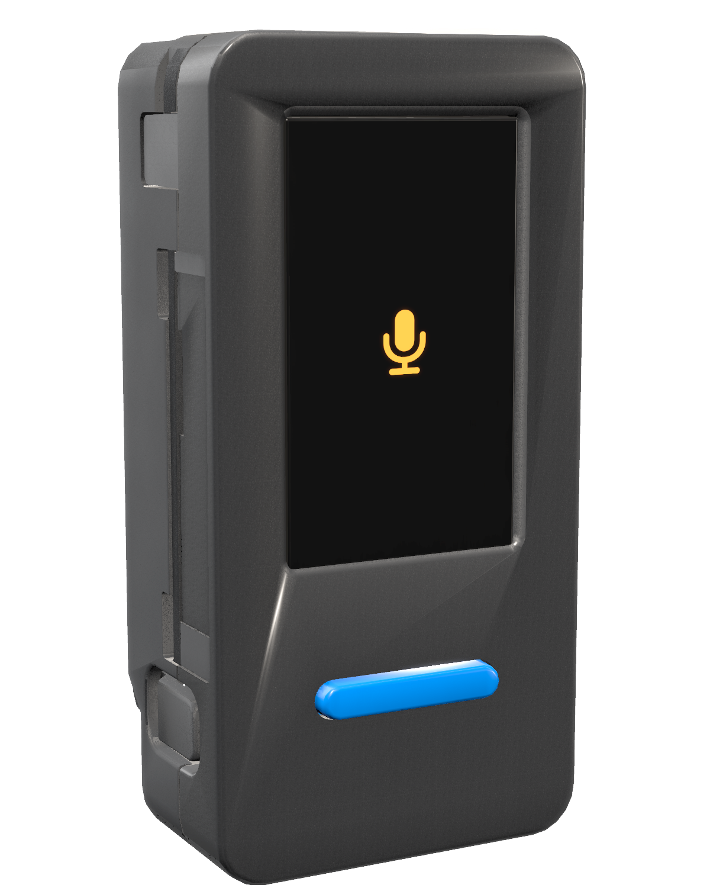
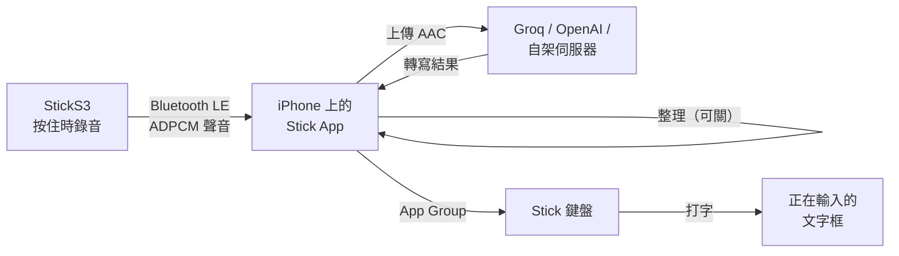
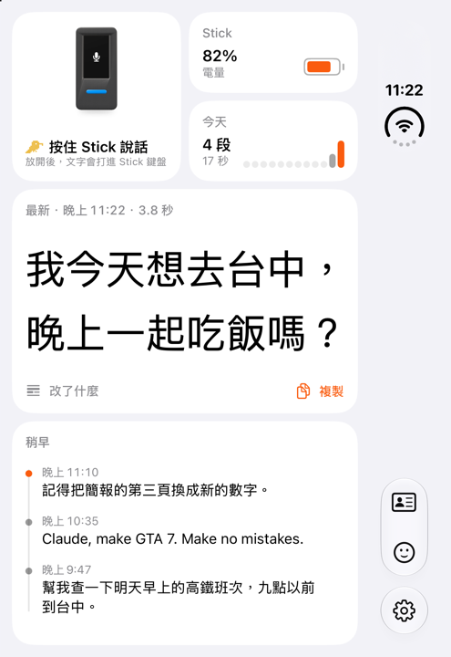

<div align="center">



# M5Stick Dictation

**按住按鍵說話，文字直接打進 iPhone 正在輸入的地方。** M5Stack StickS3 負責錄音，iPhone 負責轉寫，再由自己的鍵盤打出來。

[](LICENSE)
[](#編譯-app)
[](https://docs.m5stack.com/en/core/StickS3)
[](#燒錄-stick)

[English](README.md) · [繁體中文](README.zh-TW.md)

</div>

> [!IMPORTANT]
> 需要一台 [M5Stack StickS3](https://docs.m5stack.com/zh_CN/core/StickS3)，以及轉寫服務（Groq 或 OpenAI）的 API key，或自架的轉寫伺服器。本專案與 M5Stack、Groq、OpenAI 無關。

## 現況

| 部分 | 現況 |
|---|---|
| **Stick** | 按住說話，或點一下開始、再點一下送出。閒置 15 秒進入深度睡眠；按一下即醒，手機重新連上前已在錄音。螢幕跟隨手機語言，中文或英文 |
| **iPhone App** | 配對、轉寫、整理、紀錄、Stick 設定。每天在 iPhone Duo（iOS 27）上使用 |
| **Stick 鍵盤** | 把結果打進任何輸入框；內建小麥注音的注音輸入；常用資訊與顏文字 |
| **轉寫服務** | 日常使用 Groq。OpenAI 與相容 OpenAI API 的伺服器已支援，尚未實測 |

## 快速開始

1. 燒錄 Stick（見[燒錄 Stick](#燒錄-stick)）。
2. 安裝 App：用 Xcode 編譯（[編譯 App](#編譯-app)），或從 [Releases](../../releases) 側載 IPA（[不用 Xcode 安裝](#不用-xcode-安裝)）。
3. 打開 App 和 Stick，在跳出的卡片上點「連線」。
4. 在 App 的設定選擇轉寫服務，貼上 key。
5. 加入鍵盤：設定 › 一般 › 鍵盤 › 鍵盤 › 新增鍵盤 › Stick，並打開「允許完整取用」。
6. 按住 Stick 正面的按鍵說話。

## 運作方式





- **Stick 錄音並即時傳送。** 16 kHz 的聲音壓成 IMA ADPCM，一邊說一邊經藍牙 LE 送出。詳見 [PROTOCOL.md](PROTOCOL.md)。
- **兩次聽寫之間 Stick 會睡著。** 按鍵把它從深度睡眠叫醒，麥克風比藍牙先啟動。手機連回來之前，最多 120 秒的聲音暫存在 PSRAM，第一個字不會掉。
- **iPhone 負責轉寫。** 先切掉靜音，把說話的部分轉成 AAC 再上傳。Whisper 不帶任何 prompt：帶了 prompt，靜音時會把 prompt 的內容吐回來。
- **整理可開可關。** 由聊天模型（或手機上的 Apple Intelligence）補標點、刪贅字、處理說錯重講，或改寫語氣。
- **鍵盤負責打字。** iOS 不讓背景中的 App 貼上，所以結果先放進 App Group，再由 Stick 鍵盤讀出、插入。

<br clear="right">

## 常見問題

**支援哪一款 Stick？** M5Stack StickS3（ESP32-S3、ES8311 編解碼晶片）。舊款 StickC Plus 的麥克風和電源晶片不同，不支援。

**App 在背景也能用嗎？** 可以。藍牙會喚醒 App 轉寫，鍵盤下次打開時打出結果；鍵盤開著時立刻打出。

**能用哪些轉寫服務？** Groq、OpenAI，或任何提供相容 OpenAI `/v1/audio/transcriptions` 的伺服器，例如 [whisper.cpp](https://github.com/ggml-org/whisper.cpp) 的 server 或 LocalAI。Key 只存在手機的鑰匙圈。

**鍵盤為什麼要「允許完整取用」？** 為了讀取和 App 共用的 App Group 裡的結果。鍵盤不會把任何資料送出去。

**電池能撐多久？** 目前的韌體還沒量過。Stick 閒置 15 秒進入深度睡眠，時間可在 App 裡調整。

## 已知問題

- 曾有一次 App 關掉一段時間後，要打開 App，手機才重新連上 Stick。
- Stick 的英文畫面和側載的 IPA 尚未在實機上試過。

## 編譯 App

需要 Xcode 27 和 [XcodeGen](https://github.com/yonaskolb/XcodeGen)。

```sh
cp Config/Local.example.xcconfig Config/Local.xcconfig   # 填入自己的 Team ID 和 bundle 前綴
xcodegen generate
open StickDictation.xcodeproj
```

在 iPhone 上執行 `DuoDictate` scheme。App、鍵盤和兩者共用的 App Group，都依 `Local.xcconfig` 的 bundle 前綴命名。

## 不用 Xcode 安裝

每個 release 附一份沒有簽章的 `Stick.ipa`。用 AltStore、SideStore 或 Sideloadly 安裝，這些工具會以你自己的 Apple ID 簽章。`Tools/build-ipa.sh` 產生的是同一份檔案。

## 燒錄 Stick

pioarduino 需要 Python 3.10–3.14，工具鏈佔幾 GB；`Firmware/tools/pio` 把它們放在 `~/.stickdictation-pio`（或 `STICK_PIO_ROOT` 指定的位置）。

```sh
uv venv --python 3.13 ~/.stickdictation-pio/cli
uv pip install --python ~/.stickdictation-pio/cli/bin/python platformio
cd Firmware && tools/pio run -t upload
```

長按側邊鍵 2 秒，綠燈亮起即進入下載模式，接上電腦再執行燒錄。完成後按一下側邊鍵開機。

螢幕字型是 Noto Sans TC，由 `Firmware/tools/make_fonts.py` 產生。改了 `Firmware/src/ui.cpp` 的文字後要重新執行。

## 專案結構

| 資料夾 | 內容 |
|---|---|
| `Firmware/` | StickS3 韌體（PlatformIO、pioarduino：ESP-IDF 5 上的 Arduino 3） |
| `iOS/` | Stick App |
| `Keyboard/` | Stick 鍵盤擴充 |
| `KeyboardShared/`、`Shared/` | App、鍵盤與通訊協定共用的程式碼 |
| `macOS/` | StickSim：在 Mac 上透過藍牙模擬 Stick |
| `Design/StickRender/` | 產生 App 裡的 Stick 圖片 |
| `Tools/` | 打包 IPA 與產生鍵盤資料的腳本 |

## 致謝

- [小麥注音](https://github.com/openvanilla/McBopomofo)：注音引擎與詞庫（`Vendor/McBopomofo`）。
- [M5Stack](https://github.com/m5stack/M5_Hardware)：StickS3 與外殼模型（`iOS/Resources/Model`）。
- [Noto Sans TC](https://fonts.google.com/noto/specimen/Noto+Sans+TC)：Stick 螢幕字型。

## 授權

MIT，見 [LICENSE](LICENSE)。小麥注音與 StickS3 模型為 MIT；Noto Sans TC 採 SIL Open Font License（`Firmware/fonts/OFL.txt`）。
