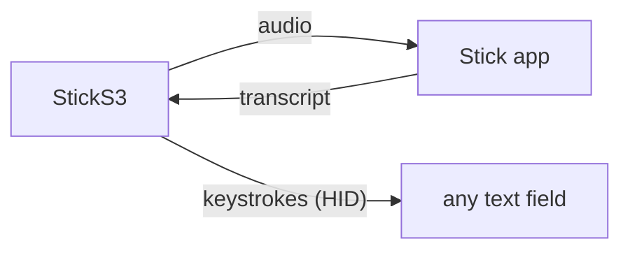

# Idea: the Stick as a Bluetooth keyboard

> [!NOTE]
> Not built yet. This describes a direction that fits English-only users well, and what it would take.

## Why there is a keyboard extension at all

Today the result reaches the text field through the Stick keyboard, a keyboard extension you switch to. It exists for one reason: **Chinese.** A key press can only send a key position, and there is no key for 你. Chinese (and Japanese and Korean) text is composed by an input method on the phone, so a Bluetooth keyboard can't type it. A keyboard extension can: it calls `insertText` with whatever text it is given.

Most other languages don't have this problem. Anything written in the Latin alphabet can be typed key by key, so if you write English, a simpler path is open.

## The idea

The StickS3 can also present itself as a **Bluetooth LE keyboard** (HID over GATT), and type the result into whatever is focused, like a real keyboard would. No custom keyboard, no switching.

And the screen gets bigger. When you are talking instead of typing, the on-screen keyboard has nothing to do, yet it takes half the screen. While a hardware keyboard is connected, iOS hides it, so the app you are writing in gets the whole screen and the Stick is the keyboard. The on-screen one comes back from the keyboard button in the corner when you need it.

## What it would take

- **A second Bluetooth service on the Stick.** The ESP32-S3 and NimBLE can run the existing Stick service and a HID keyboard side by side. iOS pairs it once in Settings › Bluetooth, like any keyboard.
- **The full text back on the Stick.** The phone already replies with the result (`DONE`, see [PROTOCOL.md](../PROTOCOL.md)), but only a 160-byte preview for the screen. The full transcript would come in chunks.
- **Typing it.** Each character becomes a key press for the US layout. A few milliseconds per key is enough for a sentence to appear in well under a second.

## Trade-offs

- **No Chinese, Japanese, Korean or emoji.** That's what the Stick keyboard is for. Accented letters need the matching layout or dead keys, so plain ASCII is the safe start.
- **One mode at a time.** With the on-screen keyboard hidden, the Stick keyboard is hidden too, so this would be a mode you choose for English, not something running beside Chinese dictation.
- **The phone's layout must be US.** HID sends key positions, not characters; a different hardware keyboard layout in iOS settings would type the wrong letters.

## Also possible once it is a keyboard

- **⌘⇧3** to take a screenshot from a button on the Stick (the side button, KEY2, is free).
- **Return, ⌘Z** and other shortcuts on the front button's long press.
