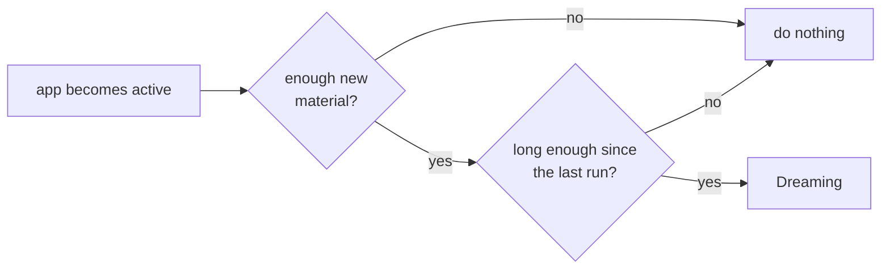

# Idea: Dreaming, learning your words from past dictations

> [!NOTE]
> Not built yet. This is a design sketch, not a commitment.

## Why

Transcription keeps making the same mistakes on the same words: your name, your project names, English terms inside Chinese sentences. Today the fix is a hand-kept list (`vocabulary` in `DictationStore`, passed to polish as `spellings`). Nobody keeps that list up to date.

The app already holds the material to build it: every transcript in history. **Dreaming** is a batch job that reads recent transcripts and writes down what it learned about how you talk, so the next dictation is polished with that knowledge.

## What it learns

| Kind | Example | Used for |
|---|---|---|
| **Terms** | `Claude Code`, `StickS3`, a colleague's name | Spelling list in the polish prompt |
| **Corrections** | heard `Cloud Code`, meant `Claude Code` | Same, as "when you see X it is probably Y" |
| **Style note** | "short messages, mixes English nouns into Chinese, no filler" | One or two lines in the polish prompt |

Whisper is **not** given any of this. A prompt makes it echo text on silence (see `Transcriber.swift`), so the fix happens in the polish step, after transcription.

## Where it runs

Apple's Private Cloud Compute (PCC), through the Foundation Models framework: the same `LanguageModelSession` that `OnDeviceRewriter` uses, with a PCC-backed model.

- **Why PCC and not Groq.** A pile of transcripts says far more about you than one recording. PCC is built so Apple cannot read the request; Groq would see everything. It also costs nothing against the Groq free quota.
- **Access.** Free for developers in the App Store Small Business Program with under two million first-time downloads, and the account needs the Private Cloud Compute entitlement. See [Apple's page](https://developer.apple.com/private-cloud-compute). **Open question:** whether an app that is only on TestFlight qualifies. Check before building.
- **Fallback.** If PCC is unavailable (offline, no entitlement, quota used), use the on-device model on a smaller batch, or skip this round. Never send transcripts anywhere else.

## When it runs: both gates must open



1. **Enough material.** Since the last run there are at least N new transcripts **and** at least M characters (starting guess: 20 and 1,500). Two thresholds so a few very long dictations, or many one-word ones, don't trigger it.
2. **Cool-down.** At least 24 hours since the last run, so opening the app ten times doesn't run it ten times.
3. **App is open.** Checked when the scene becomes active, and the work runs in the foreground with `beginBackgroundTask` for a few extra seconds to finish and save. No `BGProcessingTask`: the system decides when (or whether) to run it, which is the wrong fit for "after I have talked enough".

A "Dream now" button in settings skips the gates.

## Data

Stored as one JSON file in the app group, next to the history.

```json
{
  "lastRun": "2026-11-03T09:00:00Z",
  "terms": [
    { "text": "Claude Code", "seen": 14, "lastSeen": "2026-11-02", "state": "accepted" }
  ],
  "corrections": [
    { "heard": "Cloud Code", "meant": "Claude Code", "seen": 6, "state": "pending" }
  ],
  "style": "Short messages. English nouns inside Chinese. No filler."
}
```

- `state` is `pending`, `accepted` or `rejected`. **Only `accepted` entries reach the polish prompt.**
- Entries not seen for 60 days fade out; a rejected entry is remembered so it isn't proposed again.
- The manual `vocabulary` stays and always wins.

## How it plugs in

- `Polish.messages(...)` takes `spellings`. Pass manual terms plus accepted terms, and add accepted corrections and the style note as extra lines in the system prompt. The call site is `DictationStore.spellings`.
- A new `Dreamer` (next to `Polish`) builds the batch prompt and parses the answer. Output must be structured (a `@Generable` type in Foundation Models) so a bad answer fails the parse instead of polluting the file.
- Input is batched to fit the model's context: newest first, oldest dropped, previous profile included so it refines instead of starting over.

## Safeguards

- **Review, don't auto-apply.** A model that reads a wrong transcript can learn the wrong word and then repeat it forever. New entries land as `pending`; a small badge in settings leads to a list with accept and reject.
- **See and delete.** One screen shows everything Dreaming knows, with delete per item and "forget everything".
- **Retention.** History is the input, so it needs an age limit setting (for example 30 / 90 days / forever) and deleting a dictation should not leave its words behind unless they were accepted.
- **Off by default**, with one sentence in the UI saying what is read and where it is processed.
- **Polish guard stays.** `PolishGuard` already rejects rewrites that drift from the source; learned corrections go through it like everything else.

## Build order

1. `Profile` model, JSON storage, and the settings screen to view, accept, reject and delete. Fill it by hand to check that polish uses it.
2. `Dreamer` on the on-device model, with the gates, so the whole loop works without PCC.
3. Swap in the PCC model once entitlement is confirmed, with the on-device fallback.

## Open questions

- Does a TestFlight-only app qualify for PCC? What happens when the quota runs out?
- Is the on-device model good enough to find terms in Chinese-English mixed text, or is PCC required for this to be worth it?
- Are the starting thresholds (20 transcripts, 1,500 characters, 24 hours) about right? Measure against real history.
